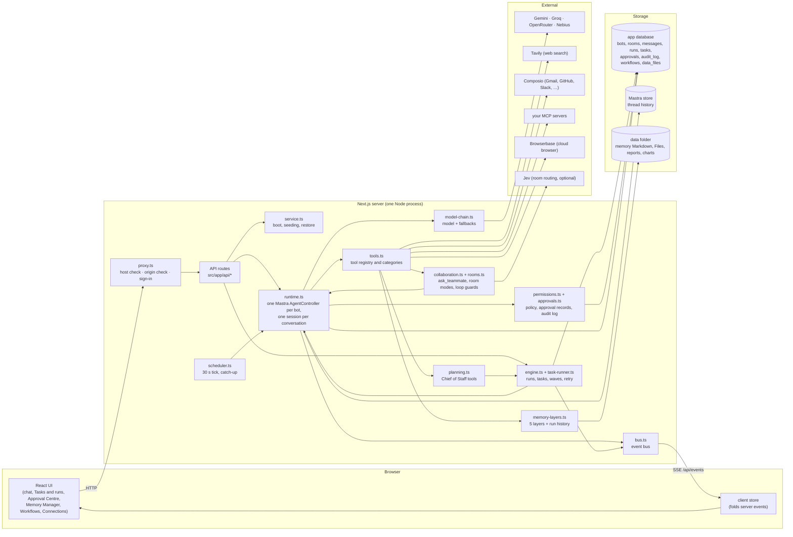
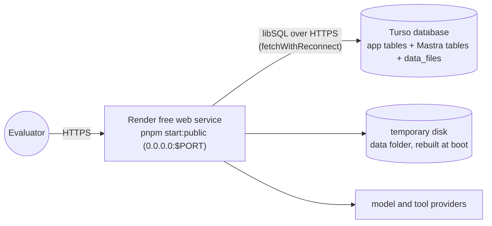
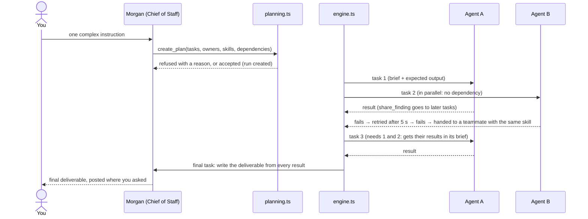

# OpenCrewBot 2.0: technical documentation

OpenCrewBot 2.0 turns the open-source [OpenCrewBot](https://github.com/Studio1-OSS/OpenCrewBot) chat app (MIT, © 2026 Studio1HQ) into an AI workforce. You give one instruction. A Chief of Staff agent turns it into a checked plan, and an execution engine runs the tasks, in parallel where it can. Specialist agents collaborate, use tools and connected apps, and remember previous work. A person approves anything that changes something outside the app.

This document covers the architecture, setup, usage, major design decisions, live versus simulated features, costs and dependencies, licences, troubleshooting and known limitations. It was written on 2026-11-19.

| | |
|---|---|
| **Live application** | <https://opencrewbot.onrender.com> (password-protected; the password is given with the submission) |
| **Repository** | <https://github.com/Hero0p/OpenCrewBot> (fork of `Studio1-OSS/OpenCrewBot`, branch `main`) |
| **Other documents** | [README](../README.md) (features and setup), [Feature audit](FEATURE_AUDIT.md) (original vs. new), [Demonstrations](DEMOS.md) (the 7 MeetUniversity demos), [Testing evidence](TESTING_EVIDENCE.md), [`evidence/`](../evidence) (exported runs) |
| **Tested environments** | Windows 11, Node.js 22.16, pnpm 11.21 (local); Render free web service, Node.js 22.16, Turso free database (deployed) |

## Contents
1. [What was built](#1-what-was-built)
2. [Architecture](#2-architecture)
3. [Execution flows](#3-execution-flows)
4. [Data model and storage](#4-data-model-and-storage)
5. [Setup](#5-setup)
6. [Usage](#6-usage)
7. [Major design decisions](#7-major-design-decisions)
8. [Live versus simulated features](#8-live-versus-simulated-features)
9. [Testing](#9-testing)
10. [Costs and dependencies](#10-costs-and-dependencies)
11. [Licences](#11-licences)
12. [Troubleshooting](#12-troubleshooting)
13. [Known limitations and unfinished areas](#13-known-limitations-and-unfinished-areas)
14. [API reference](#14-api-reference)

---

## 1. What was built

The original app was a chat client: each contact is a bot with its own model, tools and Markdown memory, and bots can share a room. It already had a good agent harness (Mastra's `AgentController`), streaming, approvals, connected apps and a mock model. It had no unit of work bigger than one chat turn, so it had no plans, tasks, parallel work, shared memory, schedules or tests. The [feature audit](FEATURE_AUDIT.md) lists every original feature and what was done with it.

What OpenCrewBot 2.0 adds, by assignment module:

| Module | What exists now | Main code |
|---|---|---|
| **A. Chief of Staff** | Morgan reads a request, answers simple questions itself, and turns team work into a plan. A plan lists tasks, each with an owner, a skill, dependencies and an expected output. The plan is checked in code before anything runs, and Morgan writes one final deliverable from every result. | `planning.ts`, `engine.ts` |
| **B. Dynamic agents** | The Agent Factory drafts a complete agent from plain words: name, role, instructions, model, tools, skills, memory, permission level and output format. The draft is checked in code and reviewed by you. Morgan can also create agents and rooms during a plan. | `agent-factory.ts`, `planning.ts` |
| **C. Collaboration** | `ask_teammate` (question, delegate, verify, challenge) and `share_finding`. Rooms can work one by one, in parallel or with review. Loop limits are enforced in code, and rooms resume after a restart. | `collaboration.ts`, `rooms.ts` |
| **D. Execution engine** | Runs and tasks are stored in the database. It handles waves of parallel tasks, retry with backoff, reassignment to a teammate with the same skill, timeouts, cancel, change of plan and restart recovery. A timeline shows each run. | `engine.ts`, `task-runner.ts`, `RunsPanel.tsx` |
| **E. Memory** | Five layers: your preferences, team decisions, project, room and agent. Plus a history of every run. Each entry records who wrote it, when, why and where. The Memory Manager lets you edit any file, and secrets are redacted. | `memory-layers.ts`, `memory-files.ts`, `MemoryPanel.tsx` |
| **F. Skills and tools** | 11 skills (`skills/*/SKILL.md`), loaded only when needed. Tools for web search, files and charts (CSV reading, SVG charts, Markdown reports), code mode and the browser. | `skills.ts`, `tools.ts`, `files.ts`, `charts.ts` |
| **G. Approvals** | Three permission levels: Ask first, Controlled (with a daily limit) and Full access. Approval cards appear in chat and in the Approval Centre, with decision history and an append-only audit log. A rejected action never runs, and a tool that hasn't been classified always asks. | `permissions.ts`, `approvals.ts`, `ApprovalCentre.tsx` |
| **H. Integrations** | Composio apps and your own MCP servers. Permissions are decided per action: reads run on their own, changes ask first. Each integration shows its real state with a badge, and app changes in mock mode are marked SIMULATED. | `app-actions.ts`, `integrations.ts`, `composio.ts` |
| **I. Scheduled workflows** | Cron or preset schedules, Run now, pause and resume. Each run is compared with the previous one, runs missed while the app was off are caught up, and failures are reported. | `scheduler.ts`, `shared/schedules.ts`, `WorkflowsPanel.tsx` |
| **J. Multi-model** | Google Gemini, Groq, OpenRouter and Nebius, through Mastra's model router. Each bot has an ordered fallback chain, and every reply shows its tokens, its cost and which model answered. | `providers.ts`, `model-chain.ts`, `models.ts` |
| **Deployment** | Public start script, password sign-in, a Turso database, a copy of the data files kept in the database, a health check, diagnostics and a Render Blueprint. | `access.ts`, `proxy.ts`, `data-mirror.ts`, `database-client.ts`, `render.yaml` |

The starting team is 10 agents and 5 rooms (`workforce.ts`), added to the original Scout, Quill, Atlas and the Studio room. That makes 13 agents and 6 rooms.

| Agent | Role | Model tier |
|---|---|---|
| Morgan | Chief of Staff (plans, consolidates; leads every workforce room) | reasoning |
| Iris | Research Analyst | tool-heavy |
| Vega | Competitive Intelligence Analyst | tool-heavy |
| Maya | Marketing Strategist | reasoning |
| Leo | Content Creator | reasoning |
| Dara | Data Analyst | tool-heavy |
| Felix | Financial Analyst | reasoning |
| Kai | Software Engineer | tool-heavy |
| Quinn | QA & Fact-checker | reasoning |
| Sasha | Growth & Partnerships | tool-heavy |

Rooms: Market Intelligence, Marketing Campaign, Business Analysis, Dev Team and Operations, all led by Morgan.

---

## 2. Architecture

### 2.1 Components



**The agent loop is Mastra's, not ours.** Each bot is a Mastra `Agent` inside an `AgentController`, and each conversation is a Mastra session. The session handles model calls, tool calls, thread history, approvals and "ask the user" pauses. `runtime.ts` builds each bot's agent (instructions, tools, model chain, memory) and folds the controller's events into the chat messages the UI shows. Everything new plugs into Mastra's documented extension points: tools, instruction sections, processors and the model list.

**One process, one event stream.** All state changes go through `bus.ts` and reach the browser over a single Server-Sent Events connection (`/api/events`). Runs, tasks, approvals and workflow runs reuse the same stream as chat messages.

### 2.2 Agent orchestration

There are three ways work moves between agents. Each one has limits enforced in code.

| Way | Who starts it | How it runs | Limits |
|---|---|---|---|
| **Team plan** | The Chief of Staff calls `create_plan` | The engine runs each task as an agent turn in that task's own conversation (`task:<id>`). | At most 8 tasks per plan; `OPENCREWBOT_MAX_PARALLEL_TASKS` at once (default 3); 2 attempts per agent; a timeout of `OPENCREWBOT_TASK_TIMEOUT_MINUTES` (default 15) per attempt |
| **Teammate request** | Any agent calls `ask_teammate` (question, delegate, verify, challenge) | The teammate answers in its own conversation, and the answer is returned to the asker as the tool result. | A chain at most 3 agents deep, and nobody is asked back by someone already waiting on them. The same question is asked only once. 3 exchanges per pair and 12 per piece of work, within a 200,000-token budget, with a 5-minute answer timeout. |
| **Room** | A message in a room | `@mention` → Jev (when configured) → the room's lead. Modes: one by one, in parallel, or with review (the fact-checker reviews the answers). | 8 replies per message, at most 2 hand-offs between the same two bots, and a hand-off depth of 2 |

**What the planner sees.** Morgan's instructions include the team roster with each teammate's role and skills (`planningSections` in `planning.ts`). The plan it proposes is checked before anything starts. A plan is refused when it:
- names an unknown teammate;
- assigns a task to the planner itself;
- gives a task to an owner who lacks the skill (the error names who has it);
- has an unknown dependency;
- contains a cycle.

Morgan gets the error back and corrects the plan.

### 2.3 Memory

| Layer | File (in the data folder) | Read by |
|---|---|---|
| Your preferences | `memory/user.md` | every bot, every turn |
| Team decisions | `memory/decisions.md` (latest entries) | every bot |
| Project | `memory/projects/<project>.md` (the active project) | every bot |
| Room | `memory/rooms/<roomId>.md` | bots working in that room, and tasks started there |
| Agent | `workspaces/<botId>/MEMORY.md` | that bot only |
| Run history | `memory/history/<run>.md` | written after each team run |

- **Writing:** bots write with `memory_add` (choosing the layer and giving a reason) and fix lines with `memory_edit`.
- **Stamps:** each entry carries a hidden stamp: `<!-- by: Maya | when: … | why: … | in: … -->`. The Memory Manager shows the stamps, and prompts leave them out.
- **Hand edits:** a file you edit by hand is what the bots read from their next turn.
- **Secrets:** anything that looks like a key, token or password is redacted before it's written.
- **Mastra's history:** Mastra keeps the model-facing thread history separately, in its own store.

### 2.4 Tools, skills and permissions

Every tool has a category (`toolCategory()` in `tools.ts`), and each permission level turns into one policy per category, which Mastra enforces in the session:

| Category | Ask first | Controlled | Full access |
|---|---|---|---|
| Lookups (search, read page, own memory, files, skills, planning, teammates) | runs | runs | runs |
| App and MCP actions that change something, browser actions | asks | runs if pre-approved, up to 20 per 24 hours (`DEFAULT_AUTO_ACTIONS_PER_DAY`); otherwise asks | runs |
| `other` (any tool not yet classified) | asks | asks | asks |

Connected apps are reached through three tools: `find_app_actions`, `read_from_app` and `act_in_app`.
- **`read_from_app`** runs only actions that read (GET, LIST, SEARCH, FETCH…) and refuses any action that changes something.
- **`act_in_app`** always goes through the approval policy. Its card shows the bot's summary in plain words and the exact inputs.
- **Repeated failures:** after 2 failures of the same action within 15 minutes, the bot is told to stop and explain what it needs. A failure returns the inputs the action expects, so the bot can correct its call.

Skills are Markdown procedures in `skills/<id>/SKILL.md`. A bot's prompt lists only the descriptions of its own skills, and it calls `load_skill` to read a full procedure when a task matches. Adding a skill needs no code change.

### 2.5 Integrations

| Integration | How | State in the app |
|---|---|---|
| Composio (1,000+ apps) | `@composio/core` sessions; Connect opens the app's own sign-in page | LIVE / NOT CONNECTED / NOT CONFIGURED / NOT WORKING |
| MCP servers | `@mastra/mcp`, by URL and token (GitHub preset included) | LIVE after a successful test / UNTESTED / NOT WORKING |
| Tavily | `@tavily/core`, behind small tool schemas every provider accepts | key set or not |
| Browserbase | `@mastra/agent-browser`, a live view embedded in chat | key set or not |
| Jev (TypeSafe) | HTTP routing call for Auto rooms; without a key, the room's lead answers | key set or not |

### 2.6 Deployment architecture



- **Sign-in** (`access.ts`): `OPENCREWBOT_PASSWORD` turns it on.
  - The session cookie is an HMAC of the password: HttpOnly, SameSite=Lax, Secure on HTTPS, valid for 30 days.
  - A wrong password waits 600 ms, and 10 failures in 15 minutes from one address are answered with 429.
  - On a public host without a password, the app refuses to serve.
- **Hosts** (`proxy.ts`): the app answers on localhost, on `OPENCREWBOT_ALLOWED_HOSTS`, and on Render's own host name. Requests from other websites are refused.
- **Storage:** with `OPENCREWBOT_DB_URL`, the app's tables and Mastra's share one Turso database.
  - Memory files, uploads, reports and charts are also copied into the `data_files` table.
  - At boot, `restoreDataFiles()` writes back any file the disk is missing, because Render wipes its disk on every restart.
- **Connection drops** (`database-client.ts`): a database request that fails because Turso closed the connection (`UND_ERR_SOCKET`, `ECONNRESET`) is sent once more on a new connection.
- **Health and diagnostics:** `/api/health` is open, for Render's health check. `/api/diagnostics` needs sign-in. It reports whether the database and each provider can be reached, and which keys are set, never their values.

---

## 3. Execution flows

### 3.1 One chat message

1. The browser posts the text to `/api/conversations/[id]/messages`. The proxy checks the host, the origin and the session.
2. `runtime.ts` queues a turn for each bot that should answer (several in a room) and sends the text into that bot's Mastra session.
3. The session calls the bot's model. On a provider error (rate limit or outage), it moves down the bot's fallback chain (`model-chain.ts`); a malformed tool call retries the step.
4. Tool calls pass the permission policy. A call that needs approval pauses the session and creates an approval record, a chat card and an Approval Centre entry.
5. Controller events (text, reasoning, tool start and end, usage) are folded into one `ChatMessage`. It's saved, and each change is published on the bus, which streams it to the browser.
6. When the turn ends, the reply records which model answered, its tokens and its cost.

### 3.2 A team plan



- **Waves:** every task whose dependencies have ended starts, up to the parallel limit. A task's brief includes its dependencies' outputs (up to 8,000 characters each) and the findings shared so far (up to 12).
- **Failure handling:**
  1. A failed attempt is retried after 5 s, then after 20 s.
  2. After 2 attempts, the task is handed to another agent with the same skill.
  3. Only then is it marked failed, and the rest of the plan carries on without it.
  4. A failed final write-up still posts every task's result, unedited, and **Retry** on the final task reopens the plan.
- **Changes mid-run:** `update_plan` cancels or adds tasks, and `feeds` lets a new task feed one that's still waiting. `plan_status` reports progress.
- **Restarts:** runs and tasks live in the database. At boot, interrupted tasks go back in the queue without losing an attempt.
- **Visibility:** progress notices go to the conversation where the plan started. **Tasks and runs** shows status, owner, attempts, timing, each task's transcript and the run's history. **Save as evidence** exports the run to `evidence/`.

### 3.3 Approval

1. A tool in the "asks" category is called.
2. Mastra suspends the session, and `approvals.ts` records the request with a secret-free preview of its inputs.
3. The card shows in the chat, in the Approval Centre, and in the task's own conversation when it belongs to a plan.
4. What happens next:
   - **Approve:** the tool runs once, with exactly the inputs shown.
   - **Reject:** the tool's code is never called. The bot is told why and adapts, and the audit log records `approval.rejected` then `tool.not_run`.
   - **Server restart or Stop:** pending requests expire, and their tools never run.

### 3.4 A scheduled workflow

The scheduler checks every 30 seconds and computes the next run times with `croner`. The shortest interval is 5 minutes. A due run sends the workflow's instruction, together with the previous run's result, to its agent. When that agent is the Chief of Staff, the run can become a team plan, which has up to 2 hours to finish.

The run's status, trigger, duration, result, report file and transcript are saved. A run that was due while the app was off runs once at the next start ("catch-up"). A failed run is posted in the agent's chat.

---

## 4. Data model and storage

| Table | Holds |
|---|---|
| `bots`, `rooms` | Agent and room definitions (JSON in `data`) |
| `messages`, `conversations` | The chat transcript the UI shows; read state and the reset generation per conversation |
| `runs`, `tasks` | The execution engine's state: plan, status, owner, attempts, timing, outputs, errors, events |
| `room_rounds` | A room message in progress, so it can resume after a restart |
| `approvals`, `audit_log` | Approval requests and decisions; the append-only log of tool calls and decisions |
| `workflows`, `workflow_runs` | Schedules and their run history |
| `settings` | Preferences, the active project, the "original bots created" marker |
| `data_files` | The copy of the data folder's files, used when the database is hosted |
| `mastra_*` | Mastra's thread history (its own store; the same database when hosted) |

Locally, the data lives in `data/opencrewbot.db` and `data/mastra.db`, plus the Markdown and Files folders in `data/`. Change the location with `OPENCREWBOT_DATA_DIR`. App writes are keyed upserts (`ON CONFLICT … DO UPDATE`), so repeating one leaves the same row.

---

## 5. Setup

### 5.1 Run locally

Requirements: Node.js 22.13 or newer and pnpm (the repo pins `pnpm@11.21.0`; `corepack enable` installs it).

```sh
git clone https://github.com/Hero0p/OpenCrewBot.git
cd OpenCrewBot
pnpm install
cp .env.example .env      # add the keys you have; every key is optional
pnpm dev                  # http://localhost:3000
```

With no model key, every bot runs on the scripted mock model. It calls the real tools and the real engine, and its output is labelled SIMULATED. Add at least one model key for live answers. A paid Gemini key is the most reliable for demos, because free tiers run out quickly (see [Costs](#10-costs-and-dependencies)).

| Variable | Purpose |
|---|---|
| `GEMINI_API_KEY`, `GROQ_API_KEY`, `OPENROUTER_API_KEY`, `NEBIUS_API_KEY` | Model providers (any subset) |
| `OPENCREWBOT_DEFAULT_MODEL` | The model new bots start with |
| `OPENCREWBOT_MOCK_MODE=true` | Force the mock model even with keys |
| `TAVILY_API_KEY` | Web search and page reading |
| `COMPOSIO_API_KEY` | Connected apps (a *project* API key from platform.composio.dev → Settings → API Keys) |
| `BROWSERBASE_API_KEY` | Cloud browser |
| `TYPESAFE_API_KEY` | Jev routing in Auto rooms |
| `OPENCREWBOT_MAX_PARALLEL_TASKS`, `OPENCREWBOT_TASK_TIMEOUT_MINUTES`, `OPENCREWBOT_COLLAB_TOKEN_BUDGET` | Engine and collaboration limits |
| `OPENCREWBOT_PASSWORD` | Sign-in (required on any public address) |
| `OPENCREWBOT_DB_URL`, `OPENCREWBOT_DB_AUTH_TOKEN` | Hosted database (Turso) |

The full list, with defaults, is in the [README](../README.md#get-started) and [`.env.example`](../.env.example).

**Checks:** `pnpm exec tsc --noEmit`, `pnpm lint`, `pnpm test`, `pnpm build`.

### 5.2 Deploy (Render + Turso, both free)

1. **Turso:** create a database in the region nearest your Render region. Copy its URL (`libsql://…`) and create a token.
2. **Render:** choose New → **Blueprint** and pick the repository; Render reads `render.yaml` (free plan, branch `main`). Fill in `OPENCREWBOT_PASSWORD`, `OPENCREWBOT_DB_URL`, `OPENCREWBOT_DB_AUTH_TOKEN` and your keys, then Apply.
3. **First visit:** open `https://<service>.onrender.com`, sign in, and connect your apps in **Connections** (the deployment has its own Composio identity).
4. **Check it:** if replies fail, open `/api/diagnostics` while signed in (see [Troubleshooting](#12-troubleshooting)).

The build caps Next.js at 2 build workers (`experimental.cpus: 2` in `next.config.ts`). That took the build's peak memory from 3.7 GB to 1.1 GB, under Render's 8 GB build limit.

---

## 6. Usage

| To… | Do this |
|---|---|
| Get a piece of team work done | Message **Morgan** (or @morgan in a workforce room) with the whole goal. Follow it in **Tasks and runs** (list icon). |
| Change a running plan | Tell Morgan what changed ("also cover pricing"); it calls `update_plan`. |
| Create an agent | **+** → New bot → describe it → **Draft it** → review → **Create**. |
| Make agents work together | Put them in a room and pick the mode in the room's Settings, or ask one agent to check with another. |
| Approve or reject an action | Use the card in the chat or the **Approval Centre** (shield icon), which also has the history and the audit log. |
| Set how freely a bot acts | Bot Details → permission level (Ask first, Controlled, Full access). |
| Read or correct memory | **Memory Manager** (brain icon): every layer and file, with who wrote each line and when. |
| Connect apps | **Connections** (plug icon) → Connect, then switch the app on in the bot's Details. |
| Schedule recurring work | **Workflows** (calendar icon), or ask Morgan ("check competitors every Monday at 09:00"). |
| Change a bot's model | Bot Details → Change; it applies from the next reply. |
| Export proof of a run | Tasks and runs → a finished run → **Save as evidence**. |

The seven MeetUniversity demonstrations and how to run them are in [DEMOS.md](DEMOS.md). The home screen (house icon) has ready-made goals that go to the Chief of Staff.

---

## 7. Major design decisions

| Decision | Why | Trade-off |
|---|---|---|
| **Extend Mastra's `AgentController` instead of writing an agent loop** | It already handles streaming, tool calls, approvals, ask-user, stop and history. The assignment requires extending the original. | We follow Mastra's event model, and some behaviour (such as which errors trigger fallback) is Mastra's. |
| **A plan is a structured tool call, checked in code** | Parsing a plan out of free text breaks easily. A schema plus checks (owners, skills, dependencies, cycles, the 8-task cap) give the model a precise error to fix. | The planner needs a model that calls tools reliably. |
| **Each task runs in its own conversation (`task:<id>`)** | Tasks reuse everything a chat turn has: approvals, transcripts, memory and model fallback. A task's transcript can be opened on its own. | More conversations are stored. |
| **Engine state lives in the database** | Restart recovery, history and evidence come from the same rows. | Every state change is a database write; this matters on a remote database (hence `fetchWithReconnect`). |
| **Fixed retry, then reassignment by skill** | Most failures are rate limits or quota, which a short wait or a different agent (often on another model) gets past. | 2 attempts per agent is a fixed policy, not a learned one. |
| **Loop guards in code, not in prompts** | A prompt can't guarantee a limit. Depth, repeat, pair, total and token limits make endless delegation impossible. | Legitimate long discussions are cut off at the limits. |
| **Memory as Markdown files with provenance stamps** | People can read and edit them, and diffs are easy to review. The original already used `MEMORY.md`. Stamps answer "who decided this?". | It isn't semantic search; the bots read a bounded slice of each layer. |
| **Unclassified tools always ask; app permissions per action** | Adding a tool can never silently widen what a bot may do. Reads and writes in the same app get different treatment. | Every new tool has to be classified. |
| **App action inputs passed as JSON text** | Groq's strict tool-schema mode turned free-form objects into empty arguments, and a string field works on every provider. | The bot writes JSON inside a string. A failed call returns the expected inputs, so the bot can correct it. |
| **Small, own tool schemas for web search** | Gemini rejected Tavily's bundled schema (a boolean inside an enum), and Groq rejected optional fields. | Fewer options than the bundled tools. |
| **Multi-provider through Mastra's model router, with tiers** | No single free tier could run the workforce. Reasoning roles and tool-heavy roles prefer different models, which also spreads quotas. | Model quality differs between fallbacks; replies say which model answered. |
| **Our own scheduler instead of Mastra workflows** | Mastra workflows are declared in code; users create schedules at runtime from the UI. | We maintain catch-up and history ourselves (tested). |
| **Mock mode runs the real pipeline** | The UI, engine, approvals and memory can be tested and demonstrated without keys; output is labelled SIMULATED. | Mock plans are scripted, not intelligent. |
| **Single-owner sign-in: an HMAC cookie, with no session table** | Enough to protect one deployment, and it survives restarts. Changing the password signs everyone out. | Not a multi-user system. |
| **Files copied into the database when hosted** | Render's free disk is wiped on restart; Turso is the durable copy. | Saves happen in the background: a write in the last moment before a stop can be lost. |

---

## 8. Live versus simulated features

| Feature | Status | How it was verified |
|---|---|---|
| Chat, streaming, tool steps, model fallback | **Live** | Real Gemini, Groq and OpenRouter models, locally and on Render |
| Chief of Staff plans, parallel tasks, final deliverable | **Live** | Live runs on 2026-11-18 and 19 (`evidence/`, demo video) |
| Failure recovery (retry, reassignment, restart) | **Live** | A task failed, was retried and reassigned; the server was killed mid-run and the run resumed ([evidence](../evidence/2026-11-18-run-study-abroad-counselling-platforms-research-plan-9d0854af.md)). The timeout is covered by tests only. |
| Collaboration (`ask_teammate`, `share_finding`, room modes) | **Live** | Live tests on 2026-11-18 ([TESTING_EVIDENCE.md](TESTING_EVIDENCE.md)) |
| Agent Factory | **Live** | Created and used live (demo video) |
| Memory layers, Memory Manager, hand edits | **Live** | Shown in the demo video; covered by tests |
| Approvals and the audit log | **Live** | A rejected action never ran ([evidence](../evidence/2026-11-18-approvals-and-audit.md)) |
| Gmail through Composio (send after approval) | **Live** | An email was sent and received on 2026-11-19 (demo video) |
| GitHub through Composio | **Connected** | Connected on the deployment; changing a repository after approval wasn't run |
| Slack and Notion | **Not verified live** | The approval gate in front of them is tested; the actions themselves weren't run |
| Scheduled workflows | **Live** | Run now twice, with the comparison, on 2026-11-18. Catch-up after downtime is covered by tests only. |
| Web search and page reading (Tavily) | **Live** | Research tasks with sources |
| Files, CSV analysis, charts, reports | **Live**, on **synthetic data** | `samples/meetuniversity-sales-SYNTHETIC.csv` is generated and labelled synthetic |
| Browserbase browser | **Built, not verified live in 2.0** | The original's path was tested against a local Chrome over CDP |
| Jev routing | **Optional, not verified live** | Without `TYPESAFE_API_KEY`, the room's lead answers |
| Nebius Token Factory models | **Built, not verified live in 2.0** | Needs `NEBIUS_API_KEY` |
| Mock model | **Simulated, labelled** | Every simulated reply, tool step, run and workflow run carries a SIMULATED badge; app changes become "SIMULATED …" reports and are never sent |

Nothing simulated is shown as live. The home screen says whether the app is running LIVE or SIMULATED, and evidence files carry the same label.

---

## 9. Testing

- **Automated:** `pnpm test` runs **162 tests in 17 files** (Vitest). They run in mock mode with a temporary data folder and never read `.env`. Highlights:
  - **Rejected actions never run**, in a real Mastra session (`approval-enforcement.test.ts`) and end to end (`app-action-approval.test.ts`).
  - **Engine:** retry, reassignment, timeout, cancel and restart recovery (`engine.test.ts`).
  - **Loop limits** (`collaboration.test.ts`).
  - **Memory provenance and hand edits** (`memory.test.ts`).
  - **Scheduler catch-up** (`scheduler.test.ts`).
  - **Deployment:** sign-in, storage selection, the files copy, and reconnecting after a closed database connection, using real sockets (`deployment.test.ts`).
- **Static checks:** `pnpm exec tsc --noEmit`, `pnpm lint` and `pnpm build` pass.
- **Live tests and evidence:** [TESTING_EVIDENCE.md](TESTING_EVIDENCE.md), and the exported runs in [`evidence/`](../evidence).
- **Known flakiness:** on 2026-11-19, one full-suite run out of 9 had a single failing test that didn't come back in the next 7 runs, and it couldn't be identified.

---

## 10. Costs and dependencies

### 10.1 Running costs

| Item | Plan used | Cost |
|---|---|---|
| Hosting | Render free web service (512 MB, sleeps after ~15 minutes idle) | $0 |
| Database | Turso free | $0 |
| Models | Gemini (paid key for the demo); Groq and OpenRouter free tiers as fallbacks | Pay per token; see below |
| Web search | Tavily free plan | $0 within its monthly credits |
| Connected apps | Composio free plan | $0 |
| Cloud browser | Browserbase (optional) | Free plan available; not used in the demo |
| Room routing | Jev (optional) | Not used |

Model list prices in $ per 1 million tokens. They come from models.dev, the catalog Mastra's router uses, and each model answered a test request on 2026-11-18 (`models.ts`):

| Model | Input | Output | Notes |
|---|---|---|---|
| Gemini 2.5 Flash | 0.30 | 2.50 | Reasoning tier |
| Gemini 2.5 Flash-Lite | 0.10 | 0.40 | Cheapest Gemini |
| GPT OSS 120B (Groq) | 0.15 | 0.60 | Fallback; free tier is 8,000 tokens/minute |
| Nemotron 3 Ultra (OpenRouter `:free`) | 0 | 0 | Tool-heavy tier; free tier is 50 requests/day |

**A typical cost.** A 5-task plan's final write-up read about 44,000 input tokens (measured on 2026-11-18). A whole plan uses roughly 150,000–300,000 input tokens across all tasks. That's about **$0.10–0.30 per plan on Gemini 2.5 Flash**, and less on Flash-Lite. $10–20 of Gemini credit is enough for recording the demo and for evaluators to run a few dozen plans.

**Free-tier limits measured on 2026-11-18:**
- Gemini 2.5 Flash: 20 requests a day.
- OpenRouter free models: 50 requests a day.
- Groq: 8,000 tokens a minute, which is less than most agent requests (8,000–130,000 tokens).

These limits are why the demo uses a paid Gemini key and why the parallel limit defaults to 3.

### 10.2 Software dependencies

| Package | Version | Licence | Used for |
|---|---|---|---|
| `next` | 16.4.0 | MIT | Web framework, API routes, proxy |
| `react`, `react-dom` | 19.3.0 | MIT | UI |
| `@mastra/core` | 1.76.0 | Apache-2.0 | Agents, `AgentController`, model router |
| `@mastra/memory`, `@mastra/libsql` | 1.37.0, 1.26.0 | Apache-2.0 | Thread history and its store |
| `@mastra/mcp`, `@mastra/agent-browser`, `@mastra/quickjs` | 2.3, 0.5.3, 0.1.3 | Apache-2.0 | MCP servers, browser, code-mode sandbox |
| `@libsql/client` | 0.18.0 | MIT | SQLite / Turso |
| `@composio/core`, `@composio/mastra` | 0.23, 0.10 | ISC | Connected apps |
| `@tavily/core` | 0.7 | MIT | Web search |
| `croner` | 10.0.1 | MIT | Cron schedules |
| `papaparse` | 5.7 | MIT | CSV reading |
| `zod` | 4.6 | MIT | Schemas for tools and inputs |
| `react-markdown`, `remark-gfm` | 10.1, 4.0 | MIT | Markdown rendering |
| `lucide-react` | 1.55 | ISC | Icons |
| `yaml` | 2.9 | ISC | Skill headers |
| `clsx`, `tailwind-merge`, `tailwindcss` | — | MIT | Styling |
| Dev: `typescript` (Apache-2.0), `vitest`, `eslint`, `eslint-config-next`, `@types/*` (MIT) | | | Type-checking, tests, lint |

Licences were read from each installed package's `package.json` on 2026-11-19. All are permissive (MIT, ISC, Apache-2.0), and all are compatible with this project's MIT licence.

---

## 11. Licences

- **This project:** MIT. The original [`LICENSE`](../LICENSE) ("Copyright (c) 2026 Studio1HQ") and the README's attribution are kept unchanged. OpenCrewBot 2.0 is a fork of [Studio1-OSS/OpenCrewBot](https://github.com/Studio1-OSS/OpenCrewBot), and the original commit history is preserved in the repository.
- **Dependencies:** see the table above. All are MIT, ISC or Apache-2.0.
- **Models:** the models are called over each provider's API, and none are bundled or redistributed. Use is governed by each provider's terms:
  - **Gemini:** Google's Gemini API terms. Free-tier data may be used to improve Google's products.
  - **GPT OSS 120B / 20B:** Apache-2.0 open weights, served by Groq under Groq's terms.
  - **Nemotron (OpenRouter, Nebius):** NVIDIA's open model licence, served under OpenRouter's or Nebius's terms.
  - **Other Nebius models (DeepSeek, Qwen, GLM, Kimi, MiniMax):** each model's own licence, as stated on its model card. Check it before commercial use.
- **Services:** Tavily, Composio, Browserbase, Turso and Render are used under their own terms of service. No service code is redistributed.
- **Data:** the sales spreadsheet in `samples/` is synthetic, generated by `samples/generate-sales-sample.mjs`. Research outputs cite their public sources.

---

## 12. Troubleshooting

| Symptom | Cause | Fix |
|---|---|---|
| Every bot reply says "Rate limit" or "quota" | Free-tier quota used up (Gemini 2.5 Flash free allows 20 requests a day) | Use a paid key, or move agents to another model in Details (e.g. a Flash-Lite model). Replies show which model answered. |
| A reply error contains `fetch failed ← …` | A network failure; the text after `←` is the real reason | Open `/api/diagnostics` (signed in). It shows which provider or database can't be reached and whether each key works (200 works, 401/403 wrong key, 429 quota). |
| `fetch failed ← other side closed (UND_ERR_SOCKET)` on Render | Turso closed an idle connection just as the app used it | Fixed since 2026-11-19 (the request is sent again). Use **Retry** on a task that failed before the fix. |
| "Request failed (502)" with no other text, on Render | Render's proxy answered because the app wasn't responding (waking up, restarting, redeploying, or out of memory) | Wait and reload. If it keeps happening, check Render → Events for "Ran out of memory". |
| The first visit takes up to a minute | The free Render service sleeps after ~15 minutes idle | Expected; open it once before a demo. |
| Connections says Composio rejected the key (401) | The key isn't a project API key (one starting `ck_` was rejected) | Create a project API key at platform.composio.dev → your project → Settings → API Keys. |
| An app action keeps failing | Wrong inputs, or the app isn't connected | After 2 failures the bot stops and explains. Check the app is LIVE in Connections and switched on in the bot's Details. |
| The approval card never appears | The bot has Full access, or the action is pre-approved under Controlled | Set the bot to Ask first. |
| Morgan answers by itself instead of planning | It judged the request simple | Say "plan this as team work for the specialists". |
| Plans stop at the final write-up | The planner's model is out of quota (the write-up reads every result, about 44,000 tokens) | Give Morgan a model with a large allowance, then **Retry** the final task. |
| Workflows didn't run overnight on Render | The free service sleeps; schedules use UTC | A missed run is caught up once on the next visit. Set times in UTC. |
| Render build fails with "Ran out of memory" | Too many build workers | Already capped (`experimental.cpus: 2`). Check that Render builds branch `main`. |
| The site says to set `OPENCREWBOT_PASSWORD` | The app refuses to serve a public host without sign-in | Set the password in Render's environment. |
| Local `pnpm dev` asks for a password and shows the deployed data | Your local `.env` has `OPENCREWBOT_PASSWORD` and the Turso variables | Comment those three lines out locally for a separate local copy. |
| Bots answer with SIMULATED badges | No model key, or `OPENCREWBOT_MOCK_MODE=true` | Add a model key and restart. |

---

## 13. Known limitations and unfinished areas

- **Unverified live:** Slack and Notion actions, GitHub changes after approval, Browserbase sessions, Jev routing and Nebius models (see [section 8](#8-live-versus-simulated-features)).
- **Covered by tests only:** the task timeout, workflow catch-up after downtime and room resume after a restart.
- **One owner.** Sign-in protects a single workspace; there are no user accounts or roles.
- **Free-tier hosting:**
  - The service sleeps, so workflows don't run while it's asleep and a missed run is made up once.
  - Its clock is UTC, and it has 512 MB of memory (a local measurement with all 13 bots loaded peaked at about 320 MB).
  - Evidence files written on Render aren't kept; export evidence locally.
  - File copies are saved in the background, so a write in the last moment before a stop can be lost.
- **Model reliability varies.** Weaker or free models sometimes skip tools, return empty replies or plan poorly. Fallbacks, step retries and the plan checks reduce this but don't remove it.
- **MCP read-only detection is by tool name** (`get_`, `list_`, `search_` …). A badly named destructive MCP tool would be treated as a lookup. Composio actions don't depend on this.
- **The Workflows screen can't edit a workflow.** It can pause, resume, run and delete one. The API (`PATCH /api/workflows/[id]`) accepts changes, but there's no form for them yet; to change one's instruction or schedule on screen, delete it and create it again.
- **Dependency updates:**
  - Next.js 16.4.0 has a published security advisory, which matters more on a public deployment. Upgrading is pending.
  - `@composio/core` 0.23 is behind the latest (0.30).
- **Memory has no semantic search.** Bots read bounded slices of each memory layer.
- **One unidentified intermittent test failure** (see [Testing](#9-testing)).

---

## 14. API reference

Every route except `/login`, `/api/auth/login` and `/api/health` needs a session when sign-in is on. Requests from other websites are refused. Input mistakes return `400` with `{ "error": "…" }`, and other failures return `500` with a message.

| Area | Routes |
|---|---|
| App | `GET /api/bootstrap` (status, bots, rooms, conversations, models), `GET /api/events` (SSE stream), `GET /api/health`, `GET /api/diagnostics` |
| Sign-in | `POST /api/auth/login`, `POST /api/auth/logout` |
| Bots | `POST /api/bots`, `PATCH/DELETE /api/bots/[id]`, `GET/PUT /api/bots/[id]/memory`, `POST /api/bots/draft` (Agent Factory) |
| Rooms | `POST /api/rooms`, `PATCH/DELETE /api/rooms/[id]` |
| Conversations | `GET/POST /api/conversations/[id]/messages`; `POST …/answer` (question card), `…/approval`, `…/stop`, `…/clear`, `…/read` |
| Runs and tasks | `GET /api/runs`, `GET /api/runs/[id]`, `POST /api/runs/[id]/cancel`, `POST /api/runs/[id]/evidence`, `POST /api/tasks/[id]/cancel`, `POST /api/tasks/[id]/retry` (runs are started by the Chief of Staff's `create_plan`) |
| Approvals | `GET /api/approvals`, `POST /api/approvals/[id]`, `POST /api/approvals/evidence` |
| Memory | `GET /api/memory`, `GET/PUT /api/memory/file`, `POST/PUT /api/memory/projects` |
| Workflows | `GET/POST /api/workflows`, `PATCH/DELETE /api/workflows/[id]`, `POST /api/workflows/[id]/run` |
| Connections | `GET /api/connections`, `POST /api/connections/changed`, `POST /api/connections/composio/connect`, `POST …/disconnect`, `GET …/search`, `POST /api/connections/mcp`, `DELETE /api/connections/mcp/[id]`, `POST /api/connections/mcp/[id]/test` |
| Files, skills, models | `GET/POST /api/files`, `GET /api/files/[...path]`, `GET /api/skills`, `GET /api/skills/[id]`, `GET /api/models` |
